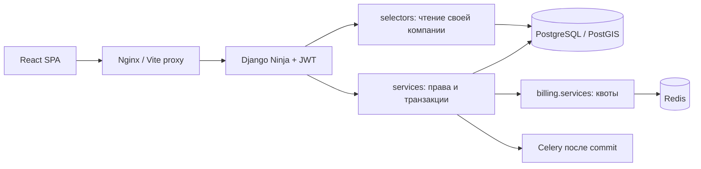

# Flowgic: руководство по трансформации и работе с приложением

Документ описывает фактически выполненную работу этапов 1–4: инфраструктуру,
JWT API, монетизацию, документы, демо-данные и React SPA. Это одновременно карта
проекта, инструкция запуска и объяснение ключевых решений для нового разработчика.
Мобильное приложение, Telegram и приём телеметрии относятся к этапу 5.

## 1. Быстрый запуск

Нужен Docker Desktop с Linux-контейнерами и Docker Compose. Для запуска в Docker
локальные Python, Node.js, PostgreSQL и Redis устанавливать не требуется.

```powershell
cd C:\repository\Flowgic
# Только при первом запуске: скопируйте пример и задайте свои случайные секреты.
Copy-Item .env.example .env
# Отредактируйте .env до запуска, не используйте пароли-заглушки из примера.
docker compose up --build -d
docker compose run --rm backend python manage.py seed_demo_company
```

Последняя команда создаёт отдельную демо-компанию; она необязательна для обычной
регистрации. Новые случайные пароли выводятся только при первом создании набора.
Повторный запуск сохраняет записи, пароли и ручные изменения. Если используется
`--password-env`, передаётся имя переменной окружения, а пароль не выводится.

Откройте **http://localhost:5173** — это новый интерфейс. API и прежние HTML-страницы
доступны на **http://localhost:8000**, описание API — `/api/docs`.
В подготовленном рабочем окружении `.env` уже существует: не перезаписывайте его
примером. Локальный демо-доступ сохранён в игнорируемом `.local/demo-credentials.json`.

По умолчанию почта выводится в консоль Celery без внешней доставки. Чтобы получать
письма восстановления на реальный email, настройте SMTP и `EMAIL_BACKEND` в `.env`.

Если порт занят, измените `FRONTEND_PORT`, `BACKEND_PORT`, `DB_PUBLISHED_PORT`
или `REDIS_PUBLISHED_PORT` в `.env`. Внутри Docker адреса сервисов остаются
`backend:8000`, `db:5432`, `redis:6379`. В этом checkout PostgreSQL опубликован на
55432, поскольку 5432 занят другой локальной службой.

```powershell
docker compose ps
docker compose logs --tail 50 backend frontend celery
docker compose stop
docker compose start
```

`docker compose down` сохраняет данные в томах. `down -v` удаляет их; эта команда
не используется для обновления приложения. После изменения кода контейнеры
обновляются командой `docker compose up --build -d`.

## 2. Как работать в приложении

1. Войдите под руководителем/диспетчером либо зарегистрируйте новую компанию.
   Регистрация создаёт самостоятельную компанию на FREE, а не присоединяет
   пользователя к существующей организации по совпадению названия.
2. Откройте «Клиенты», добавьте заказчиков и контакты. В «Транспорт» внесите
   машины и грузоподъёмность. В «Водители» создайте аккаунты водителей с начальным
   паролем; передайте его пользователю лично. Можно редактировать данные и
   блокировать аккаунты/машины, сохраняя историю перевозок.
3. В «Заказы» нажмите «Новый заказ»: выберите клиента, груз, маршрут и даты.
   Водителя и ТС можно назначить позднее. Ввод времени относится к часовому поясу
   устройства и передаётся API в ISO 8601 с UTC-смещением.
4. Найдите заказ по номеру, клиенту, грузу или маршруту. Выберите статус в фильтре.
   Пагинация работает на сервере; карточки сверху показывают данные всей компании,
   а не только открытой страницы таблицы. «Сумма за месяц» — стоимость перевозок,
   созданных в месяце UTC, а не полученные деньги.
5. «Календарь» открывает модальное окно с рейсами видимого месяца. Многодневный
   рейс виден в каждый день интервала. По номеру можно перейти в карточку.
   При большом объёме API явно сообщает ограничение в 1000 рейсов за диапазон.
6. В карточке редактируйте ресурсы и данные, меняйте статус. История показывает
   последние 100 событий. Смена статуса и финансовая запись сохраняются вместе
   с событием в транзакции.
7. В финансах введите стоимость, выплату водителю, топливо и прочие расходы.
   «Рассчитать» делает серверный предпросмотр без записи, «Сохранить расчёт»
   сохраняет данные. Переключатель топлива использует пробег заказа и историческую
   норму 30 л/100 км × 82 ₽/л. При отсутствии пробега автоматическое топливо — 0.
8. Выберите статус оплаты. Частичная оплата здесь — состояние расчёта; отдельный
   платёжный реестр/банковский эквайринг не добавлялись.
9. Скачайте «Договор-заявка DOCX» или «ТТН DOCX». Это редактируемые черновики:
   отсутствующие реквизиты и подписи дополняются сторонами. Текущая модель не
   содержит всех полей нормативной формы 1-Т.
10. Нативные партнёрские карточки показываются по контексту. Клик регистрируется
    до перехода на сайт. Демо-карточки явно помечены и ведут на `example.com`.
11. Раздел «Тариф и лимиты» показывает использование и каталог. При превышении
    квоты форма получает HTTP 402 и открывает понятное окно с переходом к тарифам.
    Смена плана — административная операция; оплата в SPA не подключена.
12. Кнопка выхода отзывает JWT-сессию и очищает данные вкладки. Аккаунту водителя
    веб-панель диспетчера недоступна; водительский контур развивается отдельно.

## 3. Исходный проект и границы миграции

Исходный прототип был монолитом Django Templates в `src/` с SQLite. Основные
сущности: компании, пользователи с ролями, внешние клиенты, машины, заказы,
финансы 1:1 с заказом, события и документы. Старые страницы и регрессионные тесты
сохранены, чтобы переход к API не ломал существующие процессы.

У заказа нет прямого `company`: он принадлежит `client.company`. Финансы и события
принадлежат компании через заказ. Это существенное отличие от абстрактного примера
из AGENTS.md: фильтры используют реальную схему, не создают вторую противоречивую
принадлежность и не переносят существующие записи в другую компанию.

Старая SQLite сохранена локально в `.local/backups/db-before-postgres.sqlite3`.
Смена ENGINE не была автоматическим переносом пользовательских записей в PostgreSQL.
Отдельная миграция исторических данных требует самостоятельной подготовки и проверки.

## 4. Этап 1 — инфраструктура и очистка

Исторический коммит: `ab97e94`. Код перенесён из `src/` в `backend/` вместе с
приложениями, шаблонами, статикой, моделями и миграциями. Обновлены пути pytest,
документация и CI. `venv/`, SQLite, `__pycache__/`, `.pytest_cache/`, логи,
`node_modules/`, сборки и секреты исключены из Git и индексации ИИ.

Созданы Dockerfile и Compose с PostgreSQL 16/PostGIS, Redis, отдельным шагом
миграций, backend, Celery и тестовым образом с Chromium/GeoDjango. PostgreSQL
использует отдельные роли: администратор первичной настройки, runtime без
SUPERUSER/CREATEDB и test с CREATEDB, но без SUPERUSER. PostGIS доступен и новым
тестовым БД через подготовленный шаблон.

Настройки читаются из окружения и локального `.env`. В контейнерах адреса
переопределяются именами сервисов. `migrate` завершается до запуска backend/Celery.
Redis разделён логическими БД: кеш — 0, брокер Celery — 1, результаты — 2.
Данные PostgreSQL/Redis сохраняются в именованных томах.

Проверены реальная версия PostGIS, пространственный POINT/SRID 4326, права ролей,
Redis, worker Celery, миграции с пустой БД и браузерные сценарии. Итог этапа —
**138 passed**. Подробности и исходные исправления регрессий:
[stage-1-verification.md](docs/stage-1-verification.md), [architecture.md](docs/architecture.md).

## 5. Этап 2 — accounts, JWT и сервисный слой

Исторический коммит: `1f9041d`. По запросу этот этап первоначально выполнялся для
`accounts`. Добавлены Django Ninja и django-ninja-jwt, единый API и разделение:

- `schemas.py` проверяет вход/выход и запрещает лишние поля;
- `selectors.py` выполняет чтение с явной принадлежностью компании;
- `services.py` управляет записью, транзакциями, паролями и токенами;
- `api.py` и сессионные адаптеры вызывают прикладные функции;
- `tasks.py` отправляет код восстановления после успешного commit.

Реализованы регистрация отдельной компании, вход, ротация refresh, проверка JWT,
выход, профиль, смена и восстановление пароля. При ротации старый refresh
попадает в blacklist. JWT проверяется по актуальному аккаунту; блокировка,
смена пароля и отзыв сессии учитываются сервером. Redis ограничивает попытки
входа и проверки одноразового кода. Ответ восстановления не раскрывает наличие email.

Появились детерминированный `backend/openapi.json`, генератор TypeScript-клиента
и CI-проверка расхождений. На этом этапе `frontend-web/` ещё содержал только SDK.
Полный pytest дал **198 passed**. Контракт и проверка:
[accounts-api.md](docs/accounts-api.md), [accounts-verification.md](docs/accounts-verification.md).

Недостающие API логистики для новой SPA добавлены на этапе 4. Старые HTML-вьюхи
остались адаптерами совместимости; полный перенос всех исторических страниц
на React не заявляется.

## 6. Этап 3 — тарифы, B2B-контекст, документы и демо

Исторический коммит: `48c0ba6`. Приложение `billing` содержит `SubscriptionPlan`
и `CompanySubscription`. Новая компания получает FREE; существующая подключается
при первом обращении к биллингу. Исходный каталог не перезаписывает настройки администратора.

| План | Активных ТС | Заказов в месяц UTC | IoT-флаг |
| --- | ---: | ---: | --- |
| FREE | 3 | 30 | нет |
| PRO | 100 | 3000 | да |
| ENTERPRISE | без ограничения | без ограничения | да |

Активны все ТС кроме `blocked`. Месячный счётчик учитывает созданные заказы,
включая отменённые. При записи блокируется подписка компании, затем считается
фактическое использование в PostgreSQL. Параллельные запросы не расходуют
последний слот дважды. Redis кеширует отображаемые счётчики на 60 секунд;
устаревший кеш не может разрешить превышение. Активация заблокированной машины
также проверяет квоту. Обычная запись не зависит от завершения Celery-задачи.

`marketplace` содержит общие/корпоративные `PartnerOffer` и `OfferClickLog`.
Страхование зависит от порога стоимости перевозки (`agreed_price`, не стоимости
самого груза); факторинг — от неоплаченных/частично оплаченных финансов;
топливные карты/телематика — от активного автопарка. Доступность и компания
повторно проверяются при клике. Сервер не запрашивает сайты партнёров.

`docxtpl` заполняет доверенные DOCX-шаблоны значениями заказа, клиента,
перевозчика, водителя и ТС. XML экранируется; чужие ресурсы в повреждённых старых
связях не раскрываются. Генерация не создаёт общих временных файлов или записей
документа в БД. Оба макета отрендерены и проверены постранично.

`seed_demo_company` использует фабрики, устойчивый UUID и явную метку демо-компании.
Создаёт 4 клиента, 3 машины, 5 пользователей, 12 перевозок, финансы, историю и
4 корпоративных демо-оффера. Весь набор создаётся атомарно. Коллизия с обычной
компанией или занятым email останавливает команду, не присваивая чужие данные.
Параметры: `--slug`, `--name`, `--orders`, `--plan`, `--password-env`.

Итоговый набор этапа и GitHub Actions — **296 passed**.
[Подробности](docs/stage-3.md), [протокол проверки](docs/stage-3-verification.md).

## 7. Этап 4 — полноценная React SPA

Существующий SDK-каталог преобразован в приложение Vite + React + TypeScript,
Ant Design, TanStack Query, React Router и Day.js. Пакеты закреплены в
`package.json`/`package-lock.json`. Локальные шрифты берутся из системного стека;
вход и работа не зависят от внешнего CDN или карты.

Реализованы вход/регистрация/восстановление, панель заказов с фильтрами и поиском,
модальный календарь, полная карточка заказа, редактирование ресурсов, финансовый
предпросмотр/сохранение, история, оба DOCX, нативные офферы, три справочника и
тарифы. Интерфейс адаптируется к телефону: навигация переходит в drawer,
карточки перестраиваются, широкие таблицы прокручиваются внутри панели.

Фильтры заказов хранятся в URL, пагинация — на сервере. Загрузка, отсутствие
данных, ошибки и повтор запроса оформлены явно. Страницы загружаются по маршрутам,
чтобы не передавать все редакторы при входе. Декоративные иконки скрыты от
accessible name; формы имеют подписи, ошибки и ограничения длины/сумм.

JWT-пара хранится в `sessionStorage` вкладки. Одновременные 401 используют один
refresh; повторяется только запрос, отклонённый авторизацией. Ответ старого
refresh не может восстановить logout или удалить новый login. После выхода
кеш отменяется/очищается. Все ключи данных включают компанию; преобразованные
представления справочников не смешиваются с сырыми DTO форм. Как и любые
JS-доступные bearer-токены, эта схема требует защиты приложения от XSS.

API дополнен списком/карточкой/редактированием заказов, обзором, календарём,
сменой статуса, финансовым предпросмотром и сохранением, чтением/созданием/
редактированием клиентов и ТС. Запись водителей остаётся в `accounts`.
Произвольные `company`, роль руководителя и `is_staff` через справочник не принимаются.
Физическое удаление исторических заказов не вводилось: используйте отмену статуса.

Общий `logistics/calculations.py` используется моделью и финансовым предпросмотром.
Формула сохранена: **client_cost − driver_cost − fuel_expenses**.
Прочие расходы хранятся отдельно. Серверный предпросмотр учитывает округление
NUMERIC PostgreSQL, не записывая строки. Изменение финансов и событие атомарны.

В OpenAPI вложенные enum `Status` получили явные имена `OrderState` и
`VehicleState`: иначе одноимённые компоненты Ninja могли смешивать наборы значений
в сгенерированном клиенте. SDK перегенерирован и проверяется TypeScript/CI.

Добавлен Nginx-контейнер `frontend`. Он раздаёт production-бандл, возвращает
`index.html` для глубоких ссылок и проксирует `/api` в backend на том же origin.
Хешированные assets кешируются, HTML всегда обновляется. Корневой `.dockerignore`
не даёт секретам и локальному окружению попасть в build context.

CI выполняет unit-тесты клиента, проверяет типы, собирает SPA, повторяет генерацию
SDK и запускает полный pytest. Docker test содержит именно production-бандл.
Новые браузерные сценарии используют живой Django API, Chromium и отдельную БД,
не подменяют ответы API и не записывают данные в рабочую компанию.

## 8. Структура и движение запроса

```text
backend/
  flowgic/        settings, общая API-сборка, URL, WSGI/ASGI, Celery
  accounts/       пользователи, JWT, профиль, справочник водителей
  logistics/      клиенты, ТС, заказы, финансы, события, DOCX, demo
  billing/        каталог тарифов, подписка и квоты
  marketplace/    контекстные офферы и клики
  templates/      сохранённые HTML-страницы
  static/         статика прежних страниц
  tests/          инфраструктура и сквозные браузерные сценарии
frontend-web/
  src/pages/      экраны приложения
  src/components/ формы и общие блоки
  src/lib/        сессия, HTTP-ошибки, форматирование
  src/client/     автоматически сгенерированный SDK — не править вручную
  nginx.conf      раздача SPA и прокси API
infra/postgres/   начальная подготовка ролей/PostGIS
docs/            подробные протоколы и контракты
```



Пользователь не выбирает tenant в запросе. Его определяет серверная JWT-идентичность.
UUID в URL не является правом доступа. Чужая запись возвращает 404, запрещённая
роль — 403, некорректный DTO — 422, доменная ошибка — 400, превышение тарифа — 402.
Чтение карточки не создаёт финансовую запись. Для списков ресурсы заранее
подгружаются, чтобы избежать N+1; повреждённые чужие назначения скрываются.

## 9. Разработка без пересборки фронтенд-контейнера

Нужен Node.js 22.18+; основной backend по-прежнему удобно запускать в Docker.

```powershell
docker compose up -d db redis backend celery
cd frontend-web
npm ci --ignore-scripts
npm run dev
```

Vite слушает `127.0.0.1:5173`, `/api` проксируется на `127.0.0.1:8000`.
Если Docker frontend уже использует 5173, остановите `docker compose stop frontend`
или укажите Vite другой порт: `npm run dev -- --port 5174`.
Для другого API задайте `API_PROXY_TARGET` в окружении процесса Vite.

Генерация из снимка воспроизводима и не зависит от запущенного сервера:

```powershell
# Из корня проекта, после изменения schemas.py/api.py:
docker compose run --rm --no-deps --volume "${PWD}/backend:/app" backend python manage.py export_openapi --output /app/openapi.json
npm run generate-api --prefix frontend-web
npm run typecheck --prefix frontend-web
```

Чтобы использовать непосредственно работающую схему:

```powershell
$env:OPENAPI_INPUT='http://localhost:8000/api/openapi.json'
npm run generate-api --prefix frontend-web
Remove-Item Env:OPENAPI_INPUT
```

## 10. Проверка и комментарии в коде

```powershell
docker compose --profile test build test
docker compose run --rm test
npm test --prefix frontend-web
npm run build --prefix frontend-web
docker compose run --rm backend python manage.py check
docker compose run --rm backend python manage.py makemigrations --check --dry-run
```

Тестовый образ сам собирает SPA и содержит Chromium. При запуске pytest с
локального Python сначала соберите `frontend-web/dist`; дополнительно нужны
GDAL/GEOS/PROJ, тестовая роль PostgreSQL/PostGIS, Redis и Chromium.

Проверяются модели и прежние процессы, JWT, изоляция компаний, конкурентная
квота, отмена транзакций, API списка/карточки, финансовый предпросмотр, enum SDK,
вход/регистрация, создание из справочника, календарь, DOCX, выход, переключение
компании, мобильная навигация и запрет панели водителю.

Комментарии добавлены в runtime-модули accounts, logistics, billing, marketplace,
flowgic и новые модули SPA: они объясняют владение данными, границы записи,
блокировки, условия пересчёта, lifecycle JWT и кеша, обработку ошибок и прокси.
Сгенерированный SDK и старые миграции не переписываются вручную ради комментариев.
Этапные результаты не заменяют проверку нового коммита: смотрите протоколы `docs/`
и GitHub Actions у актуального HEAD.

Фактические результаты этапа 4: [stage-4-verification.md](docs/stage-4-verification.md).

## 11. Что остаётся за границами четырёх этапов

Flutter, Telegram-бот, реальные GPS/IoT-данные, WebSockets и алерты — этап 5.
Тарифный IoT-флаг уже есть, приём телеметрии ещё не реализован. Маршрут пока
отображается как пункты и даты; внешний геокодер/построитель автомобильных дорог
не подключался. B2B-каталог поддерживает реальные предложения, но реальные
партнёры/доставка лидов/платёжный провайдер требуют отдельного подключения.

Compose предназначен для локальной разработки: Django runserver не становится
production-сервером из-за добавления Nginx для SPA. Публичная эксплуатация требует
TLS, промышленного WSGI/ASGI-процесса, настройки static/media, секретов, резервного
копирования, мониторинга и отдельного проверяемого deployment-процесса.

## 12. Документация используемых инструментов

- [React: компоненты и хуки](https://react.dev/reference/react).
- [Vite: запуск, сборка и proxy](https://vite.dev/guide/).
- [Ant Design с Vite](https://ant.design/docs/react/use-with-vite/).
- [TanStack Query: серверное состояние](https://tanstack.com/query/latest/docs/framework/react/overview).
