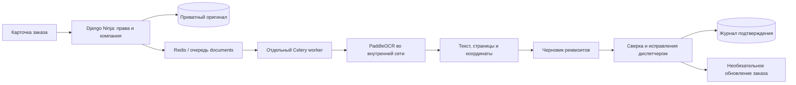

# Распознавание накладных в Flowgic

Первый рабочий модуль добавляет к заказу загрузку PDF/JPEG/PNG, локальный PaddleOCR,
черновик 37 реквизитов, просмотр оригинала, исправления и подтверждение диспетчером.
Предложения основного контура извлекает консервативный алгоритм `ru-labels-v3`.
Экспериментальный контур дообучения удалён после неудачной проверки. Поля без достаточной опоры в тексте остаются пустыми.



## Как пользоваться

В карточке заказа откройте блок **«Распознавание накладных»**. Укажите вид документа
или оставьте автоматическое определение, выберите файл и нажмите **«Распознать»**.
После обработки откройте оригинал, сверьте поля и исправьте неточности. Доступны
исходный текст, номер страницы и координаты области для каждого предложения.

Предусмотрены ТН, ТТН 1-Т, ТОРГ-12, УПД, заявки и прочие документы. Для неизвестной
формы или весового талона извлечение ограничено явно подписанными значениями;
распознавание всех вариантов формы не гарантируется. Отрицательные примеры,
например паспорт качества или путевой лист, не превращаются в накладные.

По умолчанию подтверждение сохраняет только проверенные реквизиты. Для ТН, ТТН
и заявки отдельный флажок разрешает перенести наименование груза, массу в целых
килограммах, адреса погрузки/выгрузки и согласованную стоимость перевозки. Для цены
требуются поле стоимости перевозки и явно проверенная валюта RUB. Стоимость товара
никогда не становится ценой рейса. Расчёт Financial, статус, назначение ТС/водителя
и даты заказа этим модулем не изменяются.

Если соответствующее поле заказа изменилось после загрузки, перенос отклоняется
с HTTP 409. Можно сохранить проверку без переноса и отредактировать актуальный заказ.
Повторное одинаковое подтверждение идемпотентно; изменение уже подтверждённой версии
отклоняется. Сохраняются исходные предложения и отдельный снимок исправлений с автором.

## Запуск

Для обычной CRM профиль OCR необязателен. Для работы распознавания нужны все шаги:

1. Подготовить существующий `.env` по `.env.example`, не перезаписывая его.
   Задать случайный `OCR_SERVICE_KEY`, одинаковый для Django и OCR.
2. Администратору один раз получить закреплённые модели (нужен интернет только на этом шаге):

   ```powershell
   python ocr-service/prepare_models.py --root .local/paddle-eval/models-mobile --download
   ```

   Для имеющихся моделей убрать `--download`: проверятся размер и SHA-256.
   Источники и ревизии закреплены в `ocr-service/models.lock.json`; inference также
   проверяет их при запуске. Сохранены карточки моделей с метаданными лицензий.
3. Запустить компоненты с миграциями:

   ```powershell
   docker compose --profile ocr up -d --build
   docker compose --profile ocr ps
   docker compose logs celery-documents ocr
   ```

Внутренний адрес OCR — `http://ocr:8090`, публичный порт ему не требуется.
`GET /health` подтверждает инициализацию моделей; первый полноценный инференс
проверяется загрузкой документа. Профиль поднимает отдельного worker с concurrency 1
и prefetch 1; обычный Celery продолжает обрабатывать другие задачи.

Изолированный Windows/Docker стенд описан в [ocr-test-environment.md](ocr-test-environment.md).
Отдельный запуск сервиса и HTTP-контракт — в [README OCR-сервиса](../ocr-service/README.md).
Основное приложение не устанавливает PaddlePaddle и другие ML-зависимости.

## Защита и ограничения

- JWT и активная роль dispatcher/manager обязательны. Компания берётся из пользователя.
  Унаследованная принадлежность заказа проверяется через `client__company`; собственные
  записи модуля также имеют прямой company FK. Водитель не получает доступ к OCR-оригиналам.
- Оригиналы хранятся вне публичного MEDIA, в `/ocr-private`. В Compose это общий
  `private_documents` для backend и worker. Скачивание идёт через защищённый API,
  `Cache-Control: private, no-store`, `nosniff`. При удалении записи файл удаляется
  после commit, а не до завершения транзакции. Нужны резервные копии БД **и** тома.
- Проверяется содержимое, не расширение: файл до 20 MiB, PDF без пароля до 10 страниц,
  одиночное изображение 16..12000 px по стороне и до 25 Мп. Nginx допускает multipart до 21 MiB.
- Не более 50 документов на заказ,10 активных задач и 100 загрузок за скользящие 24 часа
  на компанию. Это технические пределы MVP, не изменения тарифов billing.
- Загрузка имеет UUID upload_key и SHA-256: сетевой повтор не создаёт дубликат.
  Отправка в очередь выполняется после commit. Ошибка брокера видна пользователю.
- OCR timeout600 с, ограничения Celery660/720 с. Ручной повтор разрешён после ошибки
  или 15 минут без результата; максимум 3 начала обработки. Run-token защищает от результата
  старого worker после повторного запуска. Автоматических бесконечных повторов нет.
- OCR получает только байты и служебный ключ, не путь или URL. Модели не скачиваются
  во время обработки. Приложение не вызывает внешние AI API. Для развёртывания нужно
  дополнительно закрыть исходящий трафик OCR средствами сети/ОС; Python guard не является
  сетевым firewall. Секреты и содержимое документов не записываются в сообщения ошибок.

## API

Все пути начинаются с `/api/document-processing`:

| Метод и путь | Результат |
|---|---|
| `GET /orders/{order_id}/documents` | Документы своего заказа, максимум 50 |
| `POST /orders/{order_id}/documents` | Multipart `file`, UUID `upload_key`, `document_type=auto` |
| `GET /documents/{document_id}` | Статус, версия,37 полей, предупреждения и предложения для заказа |
| `GET /documents/{document_id}/file` | Приватный оригинал PDF/PNG/JPEG |
| `POST /documents/{document_id}/retry` | Повтор после ошибки/зависания |
| `POST /documents/{document_id}/confirm` | `version`, тип, исправленные `fields`, `apply_to_order=false` |

Статусы: `queued → processing → needs_review → confirmed`; при сбое — `failed`.
Версия требуется при подтверждении. Конфликт версии/состояния —409, неверный файл
или перенос —422, технический лимит —429, чужой/несуществующий объект —404.
Подробная схема и operationIDs находятся в `backend/openapi.json`, клиент React сгенерирован.

37 полей включают номер/дату, участников и ИНН/КПП, адреса, сроки, груз/массу/места,
водителя/госномера, стоимость перевозки и товара, валюту/НДС, ссылки на документы.
Это схема проверки, **не обещание автоматического заполнения 37 полей**. Confidence
ограничен 0.85 и не калиброван как вероятность правильности бизнес-реквизита.

## Проверка и развитие

Регрессии находятся в `backend/document_processing/test_workflow.py`,
`test_extraction.py`, `backend/tests/test_document_processing_browser.py` и
`ocr-service/test_service.py`. Для HTTP-тестов OCR не нужны веса:

```powershell
python -m pip install -r ocr-service/requirements-test.txt
python -m unittest discover -s ocr-service -p 'test_*.py' -v
```

Исправления сохраняются в DocumentReview и дают материал для будущего набора разметки.
Для обучения на новых клиентских данных нужны разрешения на их использование,
отдельная ручная проверка разметки и независимый holdout. Открытые примеры, использованные для отладки
правил, относятся к development-набору и не доказывают точность на реальном потоке.
Следующий этап — измерить точность по полям на новых документах, затем улучшать
извлечение таблиц/семантики или обучать выбранную модель по обнаруженным ошибкам.

Фактические результаты, найденные ошибки и границы проверки — в
[отчёте проверки](ai-documents-validation.md).

Отдельный локальный эксперимент дообучения описан в
[итогах эксперимента KIE](document-kie-training.md).
Кандидат не прошёл проверку на открытых development-документах и не заменяет
действующий обработчик по правилам.
